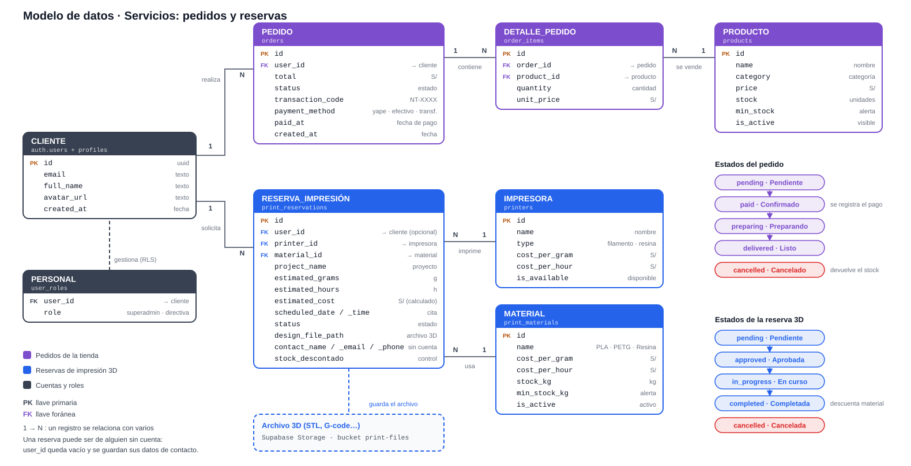
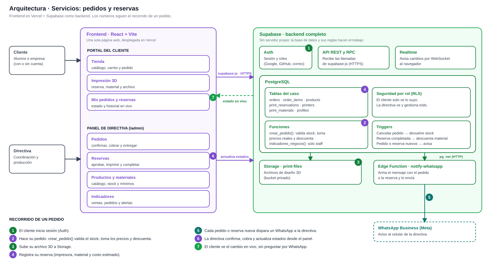

# NovaTech UNI Hub

Plataforma web del grupo de robótica NovaTech UNI: sitio público, tienda, impresión 3D, Academia Nova, Comunidad y panel de directiva.

**Sitio en producción:** https://novatech-uni-hub.vercel.app

## Tecnologías

- **Frontend:** React 18, TypeScript, Vite, Tailwind CSS y shadcn/ui. Desplegado en Vercel.
- **Backend:** Supabase (PostgreSQL con seguridad por rol, autenticación, Realtime, Storage y Edge Functions).

## Cómo trabajar en el proyecto

El flujo de ramas, los comandos y los roles están en [CONTRIBUTING.md](CONTRIBUTING.md).

```bash
npm install
npm run dev      # servidor local
npm run build    # compilar
npm test         # pruebas
```

Los cambios de base de datos son archivos en `supabase/migrations/` y se aplican a mano en Supabase. Para trabajar con los datos (revisar, limpiar datos de prueba) hay una guía explicada en [supabase/guia_datos.sql](supabase/guia_datos.sql).

## Servicios: pedidos y reservas

Es el caso de negocio principal: los pedidos de la tienda y las reservas de impresión 3D dejan de coordinarse por WhatsApp y Excel, y pasan a una sola plataforma con estado, historial e inventario.

### Modelo de datos



- **Pedidos de la tienda:** `orders`, `order_items` y `products`. El pedido guarda cómo se pagó (Yape, efectivo o transferencia) y cuándo.
- **Reservas de impresión 3D:** `print_reservations`, `printers` y `print_materials`. El costo se estima a partir de los gramos y las horas. Una reserva puede hacerla alguien sin cuenta, dejando sus datos de contacto.
- **Archivos 3D:** viven en Supabase Storage, en el bucket privado `print-files`.

### Arquitectura



- **No hay servidor propio.** El navegador habla directo con Supabase, y las reglas viven en la base de datos.
- **Stock:** `crear_pedido()` valida el stock, toma los precios reales y descuenta todo en una sola operación. Si un pedido se cancela, el stock vuelve.
- **Material de impresión:** se descuenta cuando una reserva pasa a "completada".
- **Avisos:** cada pedido o reserva nuevos disparan un WhatsApp a la directiva (Edge Function `notify-whatsapp`).
- **En vivo:** el cliente ve el cambio de estado de su pedido o reserva sin recargar (Realtime).
- **Indicadores:** la directiva ve ventas, pedidos, tiempos de entrega, lo más vendido y las alertas de stock en el panel (`/admin/indicadores`).
